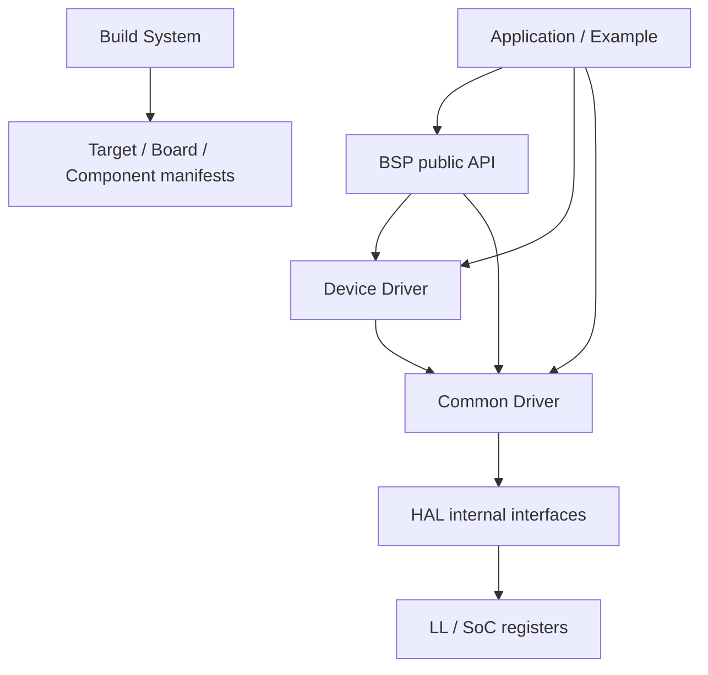

# ECOS SDK 3.0

!!! info "Version status"

    This page corresponds to ECOS Embedded SDK 3.0. In `tools/sdk-manifest.json`, `sdk_version` is
    `3.0.0`, the current release channel is `development`, and the CLI version is
    `3.0.0.dev0`. 3.0 is still under active development, so commands, manifests, and
    public APIs may continue to change; the behavior of a release is governed by the
    corresponding Git tag and SDK manifest.

This page is the entry point to the SDK 3.0 documentation, covering the version positioning, architecture layers, and board support. Installation, the CLI, project configuration, application APIs, Examples, and migration are covered in the Documentation Map below.

## Documentation Map

| Topic | Page |
| --- | --- |
| Installation and toolchain | [Installing SDK 3.0](install.md) |
| Create, build, flash | [Quick Start](quickstart.md) |
| Commands, JSON output, and automation | [`ecos` command-line tool](cli.md) |
| Project structure and configuration | [Projects and Configuration](project.md) |
| Application API overview | [Application Development](api/index.md) |
| Errors, logging, and standard skeleton | [Errors, Logging, and Standard Skeleton](api/core.md) |
| BSP / Driver / Device / Component | [BSP](api/bsp.md) · [Driver](api/driver.md) · [Device](api/device.md) · [Component](api/components.md) |
| Examples | [Example Projects](examples.md) |
| Migrating from 2.0 | [Migrating from SDK 2.0](migration.md) |
| Troubleshooting | [Troubleshooting](troubleshooting.md) |

## Positioning

ECOS SDK 3.0 is a lightweight, modular bare-metal SDK for StarrySky boards and compatible RISC-V platforms.
It draws on ESP-IDF's separation of responsibilities across Target, SoC, Driver, BSP, Component, and Example,
but it does not aim to be compatible with the ESP-IDF API or component ecosystem.

The core constraints of 3.0:

- Bare metal and static linking are the default execution model, with no RTOS dependency.
- An Example for a given feature maintains only one copy of its application source; board differences are hidden by Target/Board/Driver/BSP.
- Projects select the SDK, Board, Target, and components through manifests and a unified resolver, without copying SDK source.
- The core build uses **CMake + Ninja**, and host-side orchestration uses the **Python `ecos` CLI**.
- Windows, Linux, and macOS use the same version of the xPack RISC-V toolchain.
- CLI discovery, validation, build, and diagnostics all provide machine-readable JSON output for CI and AI consumption.

## Toolchain and Version Baseline

| Item | Baseline |
| --- | --- |
| SDK version | `3.0.0` (`tools/sdk-manifest.json`) |
| CLI version | `3.0.0.dev0` (Python package) |
| Cross toolchain | xPack GNU RISC-V Embedded GCC `15.2.0-1` |
| Compiler prefix | `riscv-none-elf-` |
| CMake | Minimum 3.20, installer pins `3.31.10` |
| Ninja | Minimum 1.10, installer pins `1.11.1.4` |
| Python | 3.9 or later |
| Supported hosts | Linux x86_64/arm64, macOS x86_64/arm64, Windows x86_64 |

!!! note "Single source of the SDK version"

    The SDK version comes from `sdk_version` in `tools/sdk-manifest.json` and cannot be
    inferred from the CLI package version, Git branch name, or installation directory
    name. `ecos --version` displays the CLI version, which is not the SDK version.

## Architecture Layers

### Layered Model

| Layer | Responsibility | Directly usable by applications |
| --- | --- | --- |
| Application / Example | Business logic | Yes (user code) |
| BSP | Board-level resources: Console, LED, Button, Display, flash and serial parameters | Yes |
| Device Driver | External devices such as ST7735, AHT20, and SGP30 | Yes |
| Driver | Stable peripheral interfaces such as GPIO, UART, I2C, PWM, QSPI, and Timer | Yes |
| HAL / LL / SoC | Register operations and SoC adaptation | **No**, SDK-internal interfaces |
| Component | Software components such as libc, heap, SFUD, FatFs, and Shell | Yes |

### Public Interfaces Visible to Applications

Applications should include only the following headers:

| Header | Contents |
| --- | --- |
| `ecos/error.h` | Error codes, result checks, and control-flow macros |
| `ecos/log.h` | Logging and panic |
| `ecos/driver/<mod>.h` | Peripheral Drivers, such as `gpio.h`, `uart.h`, and `i2c.h` |
| `ecos/bsp/<res>.h` | BSP, such as `console.h`, `led.h`, and `button.h` |
| `ecos/device/<dev>.h` | External device Drivers, such as `st7735.h` and `aht20.h` |
| `ecos/board_resources.h` | Board resource macros generated by the CLI from the Board manifest |
| `ecos/heap.h`, `sfud.h`, `ff.h`, etc. | Headers exposed by selected components |

### What Applications Must Not Use Directly

- `ecos/hal/*.h` under `hal/`: SDK-internal interfaces with no cross-version stability guarantee.
- `components/soc/*/include/*_soc.h`: SoC register definitions.
- Board `board.h`, magic pin-mux numbers, or hard-coded GPIO numbers.
- Legacy compatibility headers such as `components/core/include/log.h` and `hal_*.h`.

!!! warning "Same-name type conflicts"

    The legacy `hal/i2c/hal_i2c.h` and `hal/timer/hal_timer.h` share the type names
    `hal_i2c_config_t` / `hal_timer_config_t` with the new Driver headers. 3.x
    applications should include only `ecos/driver/i2c.h` and `ecos/driver/timer.h`,
    and must not mix headers from the two generations in the same translation unit.

## Supported Boards and Targets

A Board describes a specific development board, while a Target describes an SoC. When a project selects a Board,
the Target is derived automatically from the Board manifest, so the two are never stored as two conflicting selections.

| Board ID | Alias | Target | Default profile | Other profiles | Board family |
| --- | --- | --- | --- | --- | --- |
| `starrysky-l4-c1` | `l4c1` | `ysyx-2512-1` | `memory` | — | StarrySky L4.0 |
| `starrysky-l4-c2` | `l4c2` | `ysyx-2512-1` | `memory` | — | StarrySky L4.0 |
| `starrysky-l4-c3` | `l4c3` | `ysyx-2512-2` | `memory` | — | StarrySky L4.0 |
| `starrysky-t1-pico` | `t1-pico` | `cl1-2512` | `flash_xip` | — | StarrySky T1.0 Pico |
| `starrysky-l3` | `l3` | `ysyx-l3` | `flash-xip` | `mem` | StarrySky L3.0 |
| `starrysky-l3-1` | `l3_1`, `l3-1` | `ysyx-l3-1` | `flash-xip` | `mem` | StarrySky L3.1 |
| `starrysky-c1` | `c1` | `ysyx-c1` | `flash-xip` | — | StarrySky C1.0 |
| `starrysky-c2` | `c2` | `ysyx-c2` | `flash-xip` | `psram-data` | StarrySky C2.0 Pico |

Notes:

- Profile IDs are defined by the Board manifest and their spelling is not fully consistent (for example, `flash-xip` and `flash_xip`); always use the result of `ecos board describe <board>` as the source of truth.
- Not all Examples support all Boards. Before creating a project, use `ecos project list` to view the compatibility between Examples and Boards.
- L4C1/L4C2 share `ysyx-2512-1`, while L4C3 uses `ysyx-2512-2`; C1/C2, L3/L3.1, and T1-Pico each use their own SoC.

## Further Reading

The SDK repository (`3.0-dev` branch) provides more detailed references:

| Document | Contents |
| --- | --- |
| [`docs/api/README.md`](https://github.com/openecos-projects/embedded-sdk/blob/3.0-dev/docs/api/README.md) | Public API overview, layering, and error model |
| [`docs/api/bsp.md`](https://github.com/openecos-projects/embedded-sdk/blob/3.0-dev/docs/api/bsp.md) | BSP: Console, LED, Button, board resources |
| [`docs/api/core.md`](https://github.com/openecos-projects/embedded-sdk/blob/3.0-dev/docs/api/core.md) | Core runtime: error codes and logging |
| [`docs/cli.md`](https://github.com/openecos-projects/embedded-sdk/blob/3.0-dev/docs/cli.md) | CLI command hierarchy, arguments, and machine interfaces |
| [`docs/install.md`](https://github.com/openecos-projects/embedded-sdk/blob/3.0-dev/docs/install.md) | Installation, offline installation, multiple versions, and uninstallation |
| [`docs/schemas.md`](https://github.com/openecos-projects/embedded-sdk/blob/3.0-dev/docs/schemas.md) | Board/Target/Component/Example schemas |
| [`docs/sdk-3.0-development-boundary.md`](https://github.com/openecos-projects/embedded-sdk/blob/3.0-dev/docs/sdk-3.0-development-boundary.md) | Architecture boundaries and release acceptance criteria for 3.0 |
| [`docs/api/`](https://github.com/openecos-projects/embedded-sdk/tree/3.0-dev/docs/api) | Detailed reference for each Driver, Device, and Component |

For board pins, interfaces, and schematics, see the corresponding model page in this site's board encyclopedia.
