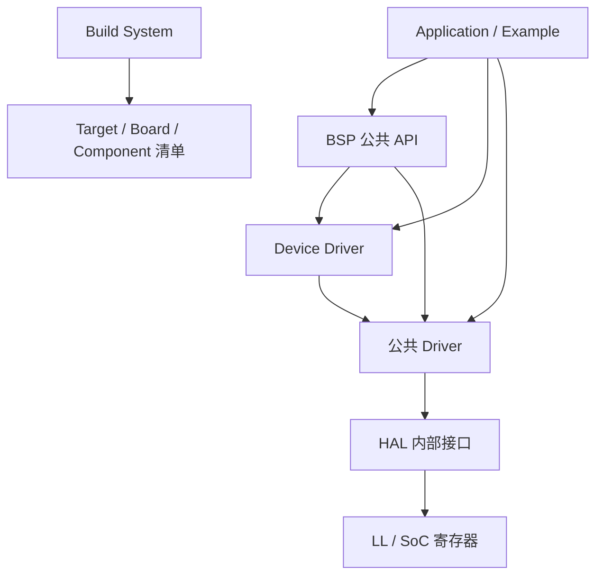

# ECOS SDK 3.0 开发指南

!!! info "版本状态"

    本文对应 ECOS Embedded SDK 3.0。`tools/sdk-manifest.json` 中 `sdk_version` 为
    `3.0.0`，当前发布通道为 `development`，CLI 版本为 `3.0.0.dev0`。3.0 仍在持续
    开发中，命令、清单和公共 API 可能继续调整；发布版行为以对应 Git tag 和 SDK
    清单为准。

本文是一份面向应用开发者的**总览与上手指南**，覆盖 SDK 3.0 的架构、安装、CLI
工作流、工程配置、公共 API 和 2.x 迁移要点。逐模块的接口参考请见文末
“进一步阅读”一节以及 SDK 仓库的 `docs/api/`。

## 1. SDK 3.0 简介

### 1.1 定位

ECOS SDK 3.0 是面向 StarrySky 板卡和兼容 RISC-V 平台的轻量、模块化裸机 SDK。
它借鉴 ESP-IDF 在 Target、SoC、Driver、BSP、Component 和 Example 上的职责分离，
但不以兼容 ESP-IDF API 或组件生态为目标。

3.0 的核心约束：

- 裸机和静态链接是默认运行模型，不依赖 RTOS。
- 同一功能的 Example 只维护一份应用源码，板卡差异由 Target/Board/Driver/BSP 屏蔽。
- 工程通过清单和统一解析器选择 SDK、Board、Target 和组件，不复制 SDK 源码。
- 核心构建使用 **CMake + Ninja**，主机侧编排使用 **Python `ecos` CLI**。
- Windows、Linux 和 macOS 使用同一版本的 xPack RISC-V 工具链。
- CLI 的发现、校验、构建和诊断都提供机器可读的 JSON 输出，方便 CI 和 AI 调用。

### 1.2 与 SDK 2.0 的主要差异

| 维度 | SDK 2.0 | SDK 3.0 |
| --- | --- | --- |
| 主机工具 | Shell 脚本 + GNU Make | Python `ecos` CLI |
| 构建系统 | Make | CMake + Ninja |
| 工具链 | `riscv64-unknown-elf-` 自编译工具链 | xPack `riscv-none-elf-gcc` 15.2.0-1 |
| 硬件抽象 | 板卡目录 + 模板 | Target / Board / HAL / Driver / BSP 分层 |
| 应用接口 | `hal_*.h`、`board.h` | `ecos/driver/*.h`、`ecos/bsp/*.h`、`ecos/device/*.h` |
| 错误模型 | 返回值不统一 | 统一 `ecos_err_t` / `ECOS_ERR_*` |
| 日志 | 旧 `log.h` | `ecos/log.h` + `ECOS_LOG*` 宏 |
| 示例组织 | 每个板卡一份应用源码 | 单一 Example 源码 + 能力清单 |
| 工程元数据 | `TEMPLATE=` / Makefile | `.ecos/project.yml` |
| 多平台 | 主要面向 Linux/WSL | Windows / Linux / macOS |
| 版本管理 | 源码目录 | SDK 注册表 + 多版本 + 工程 pin |

### 1.3 工具链与版本基线

| 项目 | 基线 |
| --- | --- |
| SDK 版本 | `3.0.0`（`tools/sdk-manifest.json`） |
| CLI 版本 | `3.0.0.dev0`（Python 包） |
| 交叉工具链 | xPack GNU RISC-V Embedded GCC `15.2.0-1` |
| 编译器前缀 | `riscv-none-elf-` |
| CMake | 最低 3.20，安装器锁定 `3.31.10` |
| Ninja | 最低 1.10，安装器锁定 `1.11.1.4` |
| Python | 3.9 或更高版本 |
| 支持宿主 | Linux x86_64/arm64、macOS x86_64/arm64、Windows x86_64 |

!!! note "SDK 版本唯一来源"

    SDK 版本来自 `tools/sdk-manifest.json` 的 `sdk_version`，不能从 CLI 包版本、
    Git 分支名或安装目录名推断。`ecos --version` 显示的是 CLI 版本，不等于 SDK 版本。

## 2. 架构分层

### 2.1 分层模型



| 层 | 职责 | 应用是否可直接使用 |
| --- | --- | --- |
| Application / Example | 业务逻辑 | 是（用户代码） |
| BSP | 板级资源：Console、LED、Button、Display、烧录与串口参数 | 是 |
| Device Driver | ST7735、AHT20、SGP30 等外部器件 | 是 |
| Driver | GPIO、UART、I2C、PWM、QSPI、Timer 等稳定外设接口 | 是 |
| HAL / LL / SoC | 寄存器操作和 SoC 适配 | **否**，SDK 内部接口 |
| Component | libc、heap、SFUD、FatFs、Shell 等软件组件 | 是 |

### 2.2 应用可见的公共接口

应用只应包含以下头文件：

| 头文件 | 内容 |
| --- | --- |
| `ecos/error.h` | 错误码、结果判定与控制流宏 |
| `ecos/log.h` | 日志与 panic |
| `ecos/driver/<mod>.h` | 外设 Driver，例如 `gpio.h`、`uart.h`、`i2c.h` |
| `ecos/bsp/<res>.h` | BSP，例如 `console.h`、`led.h`、`button.h` |
| `ecos/device/<dev>.h` | 外部器件 Driver，例如 `st7735.h`、`aht20.h` |
| `ecos/board_resources.h` | 由 CLI 按 Board 清单生成的板级资源宏 |
| `ecos/heap.h`、`sfud.h`、`ff.h` 等 | 选中组件公开的头文件 |

### 2.3 应用不得直接使用

- `hal/` 下的 `ecos/hal/*.h`：SDK 内部接口，跨版本不承诺稳定。
- `components/soc/*/include/*_soc.h`：SoC 寄存器定义。
- 板卡 `board.h`、引脚复用魔法数或直接写死的 GPIO 编号。
- 旧版 `components/core/include/log.h`、`hal_*.h` 等兼容头文件。

!!! warning "同名类型冲突"

    旧 `hal/i2c/hal_i2c.h`、`hal/timer/hal_timer.h` 与新 Driver 头文件存在
    `hal_i2c_config_t` / `hal_timer_config_t` 同名类型。3.x 应用应只包含
    `ecos/driver/i2c.h` 和 `ecos/driver/timer.h`，不要在同一编译单元混用两代头文件。

## 3. 支持的板卡与 Target

Board 描述具体开发板，Target 描述 SoC。工程选择 Board 时，Target 由 Board 清单
自动派生，二者不会保存为互相冲突的两份选择。

| Board ID | 别名 | Target | 默认 profile | 其他 profile | 对应板卡文档 |
| --- | --- | --- | --- | --- | --- |
| `starrysky-l4-c1` | `l4c1` | `ysyx-2512-1` | `memory` | — | [星空 L4.0](../../brd/starry-sky-l/v4.0.md) |
| `starrysky-l4-c2` | `l4c2` | `ysyx-2512-1` | `memory` | — | [星空 L4.0](../../brd/starry-sky-l/v4.0.md) |
| `starrysky-l4-c3` | `l4c3` | `ysyx-2512-2` | `memory` | — | [星空 L4.0](../../brd/starry-sky-l/v4.0.md) |
| `starrysky-t1-pico` | `t1-pico` | `cl1-2512` | `flash_xip` | — | [星空 T1.0 Pico](../../brd/starry-sky-t/v1.0_pico.md) |
| `starrysky-l3` | `l3` | `ysyx-l3` | `flash-xip` | `mem` | [星空 L3.0](../../brd/starry-sky-l/v3.0.md) |
| `starrysky-l3-1` | `l3_1`、`l3-1` | `ysyx-l3-1` | `flash-xip` | `mem` | [星空 L3.1](../../brd/starry-sky-l/v3.1.md) |
| `starrysky-c1` | `c1` | `ysyx-c1` | `flash-xip` | — | [星空 C1.0](../../brd/starry-sky-c/v1.0.md) |
| `starrysky-c2` | `c2` | `ysyx-c2` | `flash-xip` | `psram-data` | [星空 C2.0 Pico](../../brd/starry-sky-c/v2.0_pico.md) |

说明：

- profile ID 由 Board 清单定义，拼写并不完全统一（例如 `flash-xip` 与 `flash_xip`），
  使用时应以 `ecos board describe <board>` 的结果为准。
- 不是所有 Example 都支持所有 Board。创建工程前可用 `ecos project list` 查看
  Example 与 Board 的兼容关系。
- L4C1/L4C2 共用 `ysyx-2512-1`，L4C3 使用 `ysyx-2512-2`；C1/C2、L3/L3.1 和
  T1-Pico 分别使用各自的 SoC。

## 4. 安装 SDK 3.0

### 4.1 环境要求

- Python 3.9+，且 `python3 -m pip` 可用。
- 安装器会自动安装锁定版本的 CMake、Ninja、PyYAML、JSON Schema、Kconfiglib、
  PySerial 等主机依赖。
- 首次安装 Python wheel 需要 PyPI 或本地 pip 缓存；工具链可由安装器下载，
  也可用本地归档离线导入。
- Windows 额外安装 `windows-curses`，用于 `ecos menuconfig`。

### 4.2 从源码 checkout 安装

```bash
git clone https://github.com/openecos-projects/embedded-sdk.git
cd embedded-sdk
git checkout 3.0-dev

# 先查看安装计划，不写文件、不联网
python3 tools/install.py --dry-run --format json

# 正式安装
python3 tools/install.py
```

安装器会完成以下工作：

1. 识别当前 checkout，并以 `development` 模式把它注册为 SDK，**不复制 SDK 源码**。
2. 在用户级目录安装 Python `ecos` 启动器、CLI 依赖、CMake、Ninja 和 Shell 补全。
3. 在缺失时下载并校验 xPack `15.2.0-1` 工具链。
4. 在 Bash、Zsh、Fish 或 PowerShell 启动文件中维护带 ECOS 标记的配置块。

安装完成后重新加载 Shell 或打开新终端：

```bash
source ~/.bashrc        # Zsh 使用 ~/.zshrc
ecos sdk current
ecos toolchain status
```

!!! tip "只安装主机工具"

    只想先配置 SDK、稍后安装交叉编译器时：

    ```bash
    python3 tools/install.py --skip-toolchain
    ecos toolchain install
    ```

### 4.3 正式 release 安装

从 Release 页面下载与 `tools/sdk-manifest.json` 匹配的制品，解压后在根目录执行：

```bash
python3 tools/install.py --dry-run
python3 tools/install.py
ecos sdk current
ecos toolchain status
```

release 模式会把清单声明的文件先复制到 staging 目录，校验摘要后原子激活到
版本化目录。默认路径：

| 平台 | SDK 版本目录 |
| --- | --- |
| GNU/Linux | `${XDG_DATA_HOME:-~/.local/share}/ecos/sdk/<sdk_version>/` |
| macOS | `~/Library/Application Support/ECOS/SDKs/<sdk_version>/` |
| Windows | `%LOCALAPPDATA%\ECOS\SDKs\<sdk_version>\` |

`--prefix PATH` 指定版本目录的父目录，安装器仍会追加清单中的版本号。已安装目录视为
只读；工程、用户 BSP、工具链和下载缓存都位于独立目录。

### 4.4 离线安装工具链

```bash
python3 tools/install.py --archive /path/to/xpack-archive.tar.gz
ecos toolchain detect
ecos toolchain status --format json
```

`--archive` 只影响交叉工具链，不提供 Python wheel。安装器仍会校验归档的 SHA-256、
宿主平台和编译器身份。

### 4.5 安装验证

```bash
ecos --version                 # CLI 版本
ecos sdk current --format json # 当前解析到的 SDK
ecos sdk doctor --format json  # 所有注册项的路径和清单
ecos toolchain status          # 工具链安装状态
```

## 5. `ecos` 命令行工具

### 5.1 命令结构

```text
ecos [--sdk NAME|VERSION|PATH] <command> [subcommand] [arguments] [options]
```

命令采用“管理能力分组、高频工程操作扁平化”的模型：

- 资源管理使用分组：`ecos project create`、`ecos sdk list`、`ecos board describe`。
- 当前工程的高频操作直接位于根命令：`ecos configure`、`ecos build`、`ecos flash`。

SDK 路径解析优先级固定为：

1. 单次命令的 `--sdk`；
2. 工程元数据中的 SDK pin；
3. `ECOS_SDK_HOME` 兼容变量；
4. 用户注册表中的 active SDK；
5. 从 SDK 源码入口识别出的 checkout。

高优先级选择存在但无效时会直接报错，不会静默回退到其他 SDK。

### 5.2 常用命令

| 命令 | 作用 |
| --- | --- |
| `ecos sdk register PATH` | 注册 SDK checkout 或 release 安装 |
| `ecos sdk list / current / use / pin / doctor` | 查询、切换、固定和诊断 SDK |
| `ecos toolchain detect / status / install` | 工具链识别、状态检查与安装 |
| `ecos project list` | 列出 Example、能力需求和兼容 Board |
| `ecos project create EXAMPLE` | 从 Example 创建外部工程 |
| `ecos project set-board BOARD` | 切换 Board，并派生 Target |
| `ecos project set-target TARGET` | 只选择 Target，清空 Board |
| `ecos project set-profile PROFILE` | 切换配置 profile |
| `ecos project info` | 查看工程选择、配置和构建状态 |
| `ecos board / target / component / driver / device list` | 发现资源 |
| `ecos board / target / component / driver / device describe ID` | 查看资源详情 |
| `ecos schema list / describe / validate` | 查询和校验清单 schema |
| `ecos validate` | 只读校验工程与清单 |
| `ecos configure` | 生成 resolved project、CMake 和 Kconfig 配置 |
| `ecos menuconfig` | 进入交互式 Kconfig 配置界面 |
| `ecos build` | 使用 CMake + Ninja 构建固件 |
| `ecos clean` | 删除当前工程的构建目录 |
| `ecos doctor` | 检查工程、宿主工具、工具链、烧录器和串口 |
| `ecos flash` | 按 Board 配置烧录 `artifacts.json` 中的固件 |
| `ecos monitor` | 打开跨平台串口监视器 |
| `ecos completion bash\|zsh\|fish\|powershell` | 输出 Shell 补全脚本 |

常用示例：

```bash
ecos project list --format json
ecos board describe starrysky-l4-c1 --format json
ecos target describe ysyx-2512-1 --format json
ecos component describe driver-gpio --format json
ecos --sdk 3.0.0 project create hello --name hello-demo
```

### 5.3 机器可读输出与退出码

所有发现、检查、验证和诊断命令都支持 `--format json`。JSON 顶层固定包含：

```text
cli_version
schema_version
command
status
data
diagnostics
```

JSON 写入标准输出，日志、警告和进度写入标准错误；机器模式不包含颜色控制符。
`ecos validate --format json` 的 `data.graph` 直接给出应用源码、Target 源码、
Component 依赖和最终产物，自动化工具不需要解析 CMake/Ninja 文件。

| 退出码 | 含义 |
| --- | --- |
| `0` | 成功 |
| `2` | 用法或参数错误 |
| `3` | SDK、注册表、清单或配置错误 |
| `4` | 不支持的宿主平台或架构 |
| `5` | 工具链校验、解压或外部程序错误 |
| `6` | 网络下载错误 |

## 6. 快速上手：创建第一个工程

以下以 `starrysky-l4-c1` 为例。工程应创建在 SDK 目录之外。

### 6.1 创建工程

```bash
mkdir -p ~/ecos-workspace
cd ~/ecos-workspace

# 查看可用 Example 及其兼容 Board
ecos project list

# 从 hello 创建工程
ecos project create hello --name myhello --board starrysky-l4-c1
cd myhello
```

`--board` 与 `--target` 互斥：

- `--board` 选择完整板级支持，Target 由 Board 清单派生。
- `--target` 只选择 SoC，适合尚未绑定具体板卡的工程，此时 Board 为空。

### 6.2 工程结构

创建后的工程只包含应用源码、CMake 入口和工程元数据：

```text
myhello/
├── .ecos/
│   ├── project.yml        # 工程元数据：Example、Board、Target、profile、SDK pin
│   └── sdk.json           # 本机 SDK 解析信息（不可提交）
├── CMakeLists.txt         # 工程入口，不保存 Board/Target/组件依赖
├── ecos-example.yml       # Example 清单副本
├── main.c                 # 应用源码
└── README.md
```

`.ecos/project.yml` 的典型内容：

```yaml
schema: 2
name: "myhello"
example: "hello"
board: "starrysky-l4-c1"
target: "ysyx-2512-1"
profile: null
sdk:
  id: "ecos-embedded-sdk"
  version: "3.0.0"
  registration: "3.0.0"
```

`profile: null` 表示使用所选 Board 的默认 profile（例如 L4C1 为 `memory`）；
`ecos validate` 和 `ecos project info` 会显示最终解析出的 profile。

!!! warning "不要手工复制 SDK 内容"

    工程元数据不记录 SDK 的绝对路径。切换 Board 时，CLI 只更新工程元数据和
    生成文件，不会替换 `main.c`、`CMakeLists.txt` 等用户维护的文件。

### 6.3 校验与配置

```bash
ecos validate --project .
ecos configure --project .
```

`ecos configure` 只写 `.ecos/generated/`，原子维护以下文件：

- `resolved-project.json`：唯一的已解析工程模型；
- `resolved-project.cmake`、`sdkconfig.cmake`：CMake 输入；
- `Kconfig`、`.config`、`sdkconfig.h`：Kconfig 输入和输出；
- `configuration.fingerprint`：解析和配置指纹。

需要修改板级或驱动选项时：

```bash
ecos menuconfig
```

`menuconfig` 使用 Kconfiglib 的终端界面，选择结果持久化到
`.ecos/project.config`，退出后自动执行与 `ecos configure` 相同的派生配置生成。
该命令必须在交互式终端中运行。

### 6.4 构建

```bash
ecos build --project .
```

构建使用 CMake + Ninja，并在成功后写入 `build/artifacts.json`。以 L4C1 为例，
`build/` 中会生成：

| 产物 | 说明 |
| --- | --- |
| `retrosoc_fw.elf` | 带符号的 ELF |
| `retrosoc_fw.bin` | 烧录用二进制 |
| `retrosoc_fw.hex` | Intel HEX |
| `retrosoc_fw.txt` | 反汇编/辅助文本 |
| `retrosoc_fw.map` | 链接映射 |
| `retrosoc_fw.size` | 段大小报告 |
| `compile_commands.json` | 编译数据库，供编辑器和工具使用 |
| `artifacts.json` | 产物路径、大小、SHA-256、SDK/Board/Target/工具链和指纹 |

`artifacts.json` 还记录配置指纹。修改 Board、profile 或配置后必须重新
`ecos configure` 和 `ecos build`；`ecos flash` 只接受摘要完整且配置未过期的产物。

### 6.5 烧录与串口监视

```bash
ecos flash --project .
ecos monitor --project . --port /dev/ttyUSB0
```

- `ecos flash` 根据 Board 清单选择烧录方式，并从 `artifacts.json` 读取固件路径，
  不会猜测文件名。L4C1 使用 mass-storage 方式：CLI 在 Linux/macOS/Windows 上
  查找对应卷标，也可通过 `--device <挂载目录>` 显式指定。
- `ecos monitor` 使用 PySerial 发现或打开串口；波特率由 Board 清单配置决定，
  可用 `--baudrate` 覆盖。
- JSON 模式下监视命令必须通过 `--timeout` 或 `--expect` 保证能够结束。

### 6.6 切换板卡

同一份应用源码可以通过修改工程元数据构建到其他兼容板卡：

```bash
ecos project set-board starrysky-l4-c2
ecos configure
ecos build
```

`set-board` 会用 Board 清单中的映射覆盖 Target；`set-target` 则写入指定 Target
并把 Board 清空。两个命令都支持 `--dry-run`，用于先查看变更而不写入文件。

## 7. 工程配置与构建细节

### 7.1 profile

profile 是 Board 预定义的配置组合，用于选择启动和内存布局等：

| Board | profile | 典型用途 |
| --- | --- | --- |
| `starrysky-l4-c1` / `l4-c2` / `l4-c3` | `memory` | 运行在内存布局（链接配置由 Board 决定） |
| `starrysky-t1-pico` | `flash_xip` | Flash XIP + DSRAM |
| `starrysky-l3` / `starrysky-l3-1` | `flash-xip` | Flash XIP |
| `starrysky-l3` / `starrysky-l3-1` | `mem` | 内存运行 |
| `starrysky-c1` | `flash-xip` | Flash XIP |
| `starrysky-c2` | `flash-xip` | Flash XIP + SRAM 数据区 |
| `starrysky-c2` | `psram-data` | 数据区放在 PSRAM |

```bash
ecos project set-profile mem
ecos project info --format json
```

### 7.2 构建边界

- `.ecos/project.yml`、Board/Target/Component/Example 清单和 Kconfig 是输入事实来源。
- 生成文件只放在 `build/` 或 `.ecos/generated/`，不需要手工编辑。
- 启动文件和链接脚本由 Target/Board 清单解析后绑定到固件目标，不复制到工程。
- `CMakeLists.txt` 只声明工程和应用组件，不重复保存 Board、Target 或工具链信息。
- 不支持的 Board/Target/Example 组合会在编译前失败，并指出缺少的能力。

## 8. 应用开发接口

### 8.1 错误模型

所有公共 API 使用 `ecos_err_t`（`int32_t`）作为统一返回值：

```c
#include "ecos/error.h"

typedef int32_t ecos_err_t;

enum {
    ECOS_OK = 0,
    ECOS_ERR_INVALID_ARGUMENT = -1,
    ECOS_ERR_UNSUPPORTED      = -2,
    ECOS_ERR_NOT_INITIALIZED  = -3,
    ECOS_ERR_IO               = -4,
    ECOS_ERR_TIMEOUT          = -5,
    ECOS_ERR_BUSY             = -6,
    ECOS_ERR_NO_MEMORY        = -7,
    ECOS_ERR_NOT_FOUND        = -8,
    ECOS_ERR_INVALID_STATE    = -9,
    ECOS_ERR_INTERNAL         = -10
};
```

返回值约定：

- **0**：成功；
- **正数**：成功且携带数据，例如读写字节数、`ecos_i2c_probe` 的 ACK 结果；
- **负数**：失败，取值为 `ECOS_ERR_*`。

常用辅助接口和宏：

| 名称 | 作用 |
| --- | --- |
| `ecos_result_succeeded()` / `ecos_result_failed()` | 按“非负成功、负数失败”判定结果 |
| `ecos_err_name()` / `ecos_err_description()` | 把错误码转换为可读字符串 |
| `ECOS_RETURN_ON_ERROR(expr)` | 失败时直接返回错误码 |
| `ECOS_GOTO_ON_ERROR(expr, err, label)` | 失败时记录错误并跳转清理 |
| `ECOS_PANIC_ON_ERROR(tag, expr, op)` | 失败时打印错误并停机 |

### 8.2 日志

```c
#include "ecos/log.h"

ECOS_LOGD(tag, ...);   /* DEBUG */
ECOS_LOGI(tag, ...);   /* INFO  */
ECOS_LOGW(tag, ...);   /* WARN  */
ECOS_LOGE(tag, ...);   /* ERROR */
ECOS_LOGF(tag, ...);   /* FATAL */
ECOS_LOG_ERR(tag, error, operation);
ECOS_PANIC(tag, ...);
```

- 默认日志输出到 BSP Console；`bsp_console_init()` 成功后自动接管。
- 默认输出 ASCII、CRLF，不启用 ANSI 颜色。
- 编译期门限为 `CONFIG_ECOS_LOG_LEVEL`（默认 INFO）。日志宏在门限以下会被编译为空，
  因此建议写成 `(void)ECOS_LOGI(...)`，以同时适应两种展开。
- 日志和 panic 默认不支持在中断处理函数中调用，除非自定义 writer 支持。
- 量产固件可通过 `ecos_panic_set_handler()` 注册停机前钩子（如进入安全态）。

### 8.3 BSP

BSP 把板载 Console、LED、Button 和显示资源封装为与板卡无关的接口。

```c
#include "ecos/bsp/console.h"
#include "ecos/bsp/led.h"
#include "ecos/bsp/button.h"
```

| 接口 | 说明 |
| --- | --- |
| `bsp_console_init()` | 初始化板级控制台，通常应最先调用 |
| `bsp_console_write(text, size)` | 输出文本（CRLF），返回消费的字节数 |
| `bsp_console_read(data, size)` | 阻塞读取，CR 归一化为 LF |
| `bsp_console_try_read(&byte)` | 非阻塞读一个字节：1 读到、0 暂无、负数失败 |
| `bsp_led_init()` | 把所有板载 LED 配置为输出并熄灭 |
| `bsp_led_set_state(led, state)` | 点亮或熄灭指定 LED |
| `bsp_button_init()` | 把所有板载按键配置为输入 |
| `bsp_button_get_count()` | 返回当前 Board 的按键数量 |
| `bsp_button_get_state(button)` | 返回按下/松开状态或负错误码 |

板载资源的逻辑引脚由 CLI 生成到 `ecos/board_resources.h`，应用通过宏访问，
不要硬编码 GPIO 编号：

```c
#include "ecos/driver/gpio.h"
#include "ecos/board_resources.h"

#if !ECOS_BOARD_HAS_GPIO_DEMO
#error "this board does not provide the gpio-demo resource"
#endif

/* 宏的取值随 Board 变化；跨板代码只依赖宏名。 */
ecos_gpio_pin_t input  = ECOS_BOARD_GPIO_DEMO_INPUT;
ecos_gpio_pin_t output = ECOS_BOARD_GPIO_DEMO_OUTPUT;
```

### 8.4 Driver

Driver 是稳定的外设公共接口，头文件位于 `ecos/driver/`：

| 模块 | 头文件 | 说明 |
| --- | --- | --- |
| GPIO | `ecos/driver/gpio.h` | 输入/输出、电平读写 |
| GPIO 中断 | `ecos/driver/gpio_interrupt.h` | 引脚外部中断 |
| UART | `ecos/driver/uart.h` | 通用异步串口 |
| I2C | `ecos/driver/i2c.h` | 主机收发与设备探测 |
| PWM | `ecos/driver/pwm.h` | 占空比与通道控制 |
| Timer | `ecos/driver/timer.h` | 延时与时基 |
| Timer 中断 | `ecos/driver/timer_interrupt.h` | 周期回调 |
| QSPI | `ecos/driver/qspi.h` | QSPI 主机 |
| PS/2 | `ecos/driver/ps2.h` | PS/2 设备输入 |
| WDG | `ecos/driver/wdg.h` | 看门狗 |
| RCU | `ecos/driver/rcu.h` | 复位与时钟控制 |
| RTC | `ecos/driver/rtc.h` | 实时时钟与闹钟 |
| RNG | `ecos/driver/rng.h` | 随机数 |
| CRC | `ecos/driver/crc.h` | CRC 计算 |
| ARCHINFO | `ecos/driver/archinfo.h` | 芯片标识与架构信息 |
| CLINT | `ecos/driver/clint.h` | 机器计时器（T1-Pico） |
| Interrupt | `ecos/driver/interrupt.h` | 中断控制器 |
| SDRAM | `ecos/driver/sdram.h` | SDRAM 初始化（T1-Pico） |

Driver 统一采用“配置结构体 + 默认值宏”的初始化方式：

```c
ecos_<x>_config_t          /* 实例配置：端口、时钟、周期、引脚等 */
ECOS_<X>_CONFIG_DEFAULT    /* 与配置结构体对应的默认初始化器 */
ECOS_<X>_DEFAULT           /* 总线型模块选择实例 0 */
```

### 8.5 Device Driver

Device Driver 通过公共 Driver 访问外部器件，不直接依赖具体 Board 的引脚：

| 器件 | 头文件 | 说明 |
| --- | --- | --- |
| AHT20 | `ecos/device/aht20.h` | 温湿度传感器 |
| AT24C64 | `ecos/device/at24c64.h` | I2C EEPROM |
| SGP30 | `ecos/device/sgp30.h` | 气体传感器 |
| PCF8563 | `ecos/device/pcf8563.h` | RTC 时钟芯片 |
| ST7735 | `ecos/device/st7735.h` | SPI TFT 显示屏 |
| ST7789 | `ecos/device/st7789.h` | SPI TFT 显示屏 |
| TM1650 | `ecos/device/tm1650.h` | 数码管驱动 |
| Buzzer | `ecos/device/buzzer.h` | 蜂鸣器 |
| ESP-01S | `ecos/device/esp01s_at.h` | AT 指令 Wi-Fi 模块 |

设备驱动通过配置结构体中的总线实例 ID 指定挂载点。**必须先初始化总线 Driver，
再初始化 Device Driver**：

```c
ecos_i2c_init(&i2c_config);
ecos_aht20_init(&aht20, &aht20_config);  /* aht20_config.i2c = 0 */
```

### 8.6 Component

| 组件 | 头文件 | 说明 |
| --- | --- | --- |
| Core Runtime | `ecos/error.h`、`ecos/log.h` | 错误码、日志与 panic，默认组件 |
| libc 子集 | `string.h`、`stdio.h`、`assert.h` | 裸机编译所需的内存和字符串操作 |
| libgcc | `libgcc.h` | 乘除法、移位等运行时支持 |
| heap | `ecos/heap.h` | 堆内存管理 |
| SFUD | `sfud.h` | 串行 Flash 通用驱动 |
| FatFs | `ff.h`、`diskio.h` | FAT 文件系统 |
| Letter-Shell | `shell.h` | 命令行交互 |
| letter-shell-fs | `ecos/shell/fs.h` | Shell 文件系统扩展 |
| soft SPI | `ecos/soft_spi.h` | 软件 SPI |
| LightCoroutine | `coroutine.h` | 协程 |
| text-editor | `text_editor.h` | 文本编辑器 |
| FCC | `fcc.h` | 应用向组件 |

!!! note "首批 release 的组件范围"

    当前 `tools/sdk-manifest.json` 的 `release.exclude` 在首发发布包中排除了
    FatFs、FCC、Letter-Shell、letter-shell-fs 和 text-editor；这些组件目前
    需要在 development checkout 中使用。以后续版本的清单为准。

### 8.7 标准应用骨架

```c
#include "ecos/bsp/console.h"
#include "ecos/driver/timer.h"
#include "ecos/log.h"

#define LOG_TAG "app"

int main(void)
{
    ECOS_PANIC_ON_ERROR(LOG_TAG, bsp_console_init(), "initialize console");
    (void)ECOS_LOGI(LOG_TAG, "application started");

    for (;;) {
        ECOS_PANIC_ON_ERROR(
            LOG_TAG,
            ecos_timer_delay_ms(ECOS_TIMER_DEFAULT, 1000u),
            "delay"
        );
    }
}
```

### 8.8 完整示例：blink

```c
#include "ecos/bsp/console.h"
#include "ecos/bsp/led.h"
#include "ecos/driver/timer.h"
#include "ecos/log.h"

#define BLINK_DELAY_MS 500u
#define LOG_TAG "blink"

int main(void)
{
    int timer_count;

    ECOS_PANIC_ON_ERROR(LOG_TAG, bsp_console_init(), "initialize console");
    (void)ECOS_LOGI(LOG_TAG, "Starting blink example");

    timer_count = ecos_timer_get_instance_count();
    ECOS_PANIC_ON_ERROR(LOG_TAG, timer_count, "query timers");
    if (timer_count < 1)
        ECOS_PANIC_ON_ERROR(LOG_TAG, ECOS_ERR_NOT_FOUND, "find default timer");

    ECOS_PANIC_ON_ERROR(LOG_TAG, bsp_led_init(), "initialize LED");
    (void)ECOS_LOGI(LOG_TAG, "Blinking LED 0 every %u ms", BLINK_DELAY_MS);

    for (;;) {
        ECOS_PANIC_ON_ERROR(
            LOG_TAG, bsp_led_set_state(BSP_LED_0, BSP_LED_ON), "turn LED on"
        );
        ECOS_PANIC_ON_ERROR(
            LOG_TAG, ecos_timer_delay_ms(ECOS_TIMER_DEFAULT, BLINK_DELAY_MS),
            "wait after turning LED on"
        );
        ECOS_PANIC_ON_ERROR(
            LOG_TAG, bsp_led_set_state(BSP_LED_0, BSP_LED_OFF), "turn LED off"
        );
        ECOS_PANIC_ON_ERROR(
            LOG_TAG, ecos_timer_delay_ms(ECOS_TIMER_DEFAULT, BLINK_DELAY_MS),
            "wait after turning LED off"
        );
    }
}
```

## 9. 示例工程

`ecos project list` 会从清单实时解析 Example 与 Board 的兼容关系。当前 SDK 中的
Example 名称如下：

| 分类 | Example 名称 |
| --- | --- |
| 入门 | `hello`、`blink` |
| 显示 | `display-donut` |
| 外设 | `archinfo-chip-id`、`button-state`、`gpio-basic`、`gpio-interrupt`、`gpio-tm1650`、`pwm-basic`、`pwm-buzzer`、`ps2-keycodes`、`rcu-pll`、`rcu-status`、`rng-random`、`rtc-counter`、`timer-interrupt`、`wdg-reset` |
| 总线与存储 | `i2c-scan`、`i2c-aht20`、`i2c-at24c64`、`i2c-pcf8563`、`i2c-sgp30`、`soft-spi-jedec-id`、`spi-master-st7735`、`spi-master-st7789`、`flash-sfud` |
| 中断与系统 | `plic`、`clint-clock`、`sdram-init`、`crc-compute` |
| 通信 | `uart-esp01s` |
| 并发与 Shell | `coroutine-smoke`、`letter-shell-smoke` |
| 综合应用 | `llm-chat`、`text-editor`、`flash-fatfs`、`fcc` |

创建示例工程：

```bash
ecos project list
ecos project create blink --name myblink --board starrysky-l4-c1
cd myblink
ecos build
```

Example 名称全局唯一，创建时只使用清单中的 `name`，不带 `get_start/` 等父目录。
`letter-shell-smoke`、`text-editor`、`flash-fatfs`、`fcc` 依赖首发 release 暂未包含的
组件，需在 development checkout 中使用。

## 10. 从 SDK 2.0 迁移

3.0 允许调整目录、BSP schema、工程元数据和旧 HAL API。迁移时建议按以下顺序进行：

1. **新建 3.0 工程**，不要直接改写 2.x 的 Makefile 工程。
2. **替换头文件**：`hal_*.h` → `ecos/driver/*.h`，`board.h` → BSP 或
   `ecos/board_resources.h`，旧 `log.h` → `ecos/log.h`。
3. **统一错误处理**：使用 `ecos_err_t` 和 `ECOS_RETURN_ON_ERROR` /
   `ECOS_PANIC_ON_ERROR`。
4. **移除板卡条件编译**：不要根据 Board 名称选择引脚；改用 BSP 资源或
   `board_resources.h`。
5. **替换构建流程**：

   | 2.x | 3.0 |
   | --- | --- |
   | `ecos init_project hello -target c2` | `ecos project create hello --board starrysky-c2` |
   | `make menuconfig` | `ecos menuconfig` |
   | `make` | `ecos configure && ecos build` |
   | Makefile / `TEMPLATE=` | `.ecos/project.yml` + 清单 |
   | `riscv64-unknown-elf-*` | `riscv-none-elf-*`（由 SDK 自动解析） |

6. **验证能力兼容性**：`ecos validate --format json` 会检查 Board/Target/组件
   依赖和所需资源；不支持的组合会在编译前失败。
7. **重新做硬件回归**：工具链从 `riscv64-unknown-elf` 切换到 xPack
   `riscv-none-elf`，L3/L3.1 仍应保持 `rv64ifd_zifencei/lp64`，不得静默改为
   `lp64d`。

!!! note "2.x 工程仍可使用"

    `2.1-dev` 及后续 2.x 分支以修复和稳定为主。3.0 提供迁移文档和能力校验，
    但不保证所有 2.x 工程无修改编译。

## 11. 自动化与 AI 使用

3.0 的 CLI 同时面向人、CI 和 AI，关键约定：

- 参数完整时不会出现交互式提问；每个交互命令都有等价的非交互参数。
- 工程相关命令支持显式指定工程目录（`--project PATH`），不依赖当前工作目录。
- 查询和校验命令无副作用；修改类命令支持 `--dry-run`。
- 重复设置 Board、profile 等操作保持幂等。
- 默认不覆盖用户源码；覆盖或删除必须显式传入 `--force`。
- `--format json` 提供稳定 envelope、诊断数组和退出码。

自动化推荐流程：

```bash
ecos project list --format json
ecos board describe starrysky-l4-c1 --format json
ecos project create hello --name ci-hello --board starrysky-l4-c1 --format json
ecos validate --project ci-hello --format json
ecos configure --project ci-hello --format json
ecos build --project ci-hello --format json
```

`ecos validate --format json` 的 `data.graph` 可用于在编译前检查实际源码、
include、组件依赖和产物列表。

## 12. 故障排查

| 现象 | 排查方式 |
| --- | --- |
| `ecos: command not found` | 重新加载 Shell 启动文件或打开新终端；确认安装器已配置 PATH |
| 找不到 Kconfiglib | 运行 `python3 tools/install.py` 安装锁定依赖 |
| 解析到了错误的 SDK | `ecos sdk current --format json`，检查 `--sdk`、工程 pin 和 active SDK 的优先级 |
| 工具链状态异常 | `ecos toolchain status --format json`、`ecos toolchain install --dry-run` |
| Board/Target 不匹配 | 使用 `ecos project set-board <board>` 让 Target 由 Board 派生，再 `ecos validate` |
| 缺少外设能力 | `ecos board describe <board>` 和 `ecos project list` 查看资源与能力 |
| 构建产物缺失 | `ecos build --format json` 会报告缺少 ELF/BIN/HEX/MAP/size 或编译数据库 |
| 烧录器未找到 | `ecos doctor --project . --format json`；L4C1 可用 `--device` 指定挂载目录 |
| 串口监视不退出 | JSON 模式需要 `--timeout` 或 `--expect` |
| 工程名报错 | 工程名只能是一个 ASCII 路径段，允许字母、数字、`.`、`_`、`-` |

完整环境诊断：

```bash
ecos doctor --project . --format json
ecos sdk doctor --format json
ecos toolchain status --format json
```

## 13. 进一步阅读

SDK 仓库（`3.0-dev` 分支）内提供了更细的参考：

| 文档 | 内容 |
| --- | --- |
| [`docs/api/README.md`](https://github.com/openecos-projects/embedded-sdk/blob/3.0-dev/docs/api/README.md) | 公共 API 总览、分层与错误模型 |
| [`docs/api/bsp.md`](https://github.com/openecos-projects/embedded-sdk/blob/3.0-dev/docs/api/bsp.md) | BSP：Console、LED、Button、板级资源 |
| [`docs/api/core.md`](https://github.com/openecos-projects/embedded-sdk/blob/3.0-dev/docs/api/core.md) | 核心运行时：错误码与日志 |
| [`docs/cli.md`](https://github.com/openecos-projects/embedded-sdk/blob/3.0-dev/docs/cli.md) | CLI 命令层级、参数和机器接口 |
| [`docs/install.md`](https://github.com/openecos-projects/embedded-sdk/blob/3.0-dev/docs/install.md) | 安装、离线安装、多版本和卸载 |
| [`docs/schemas.md`](https://github.com/openecos-projects/embedded-sdk/blob/3.0-dev/docs/schemas.md) | Board/Target/Component/Example schema |
| [`docs/sdk-3.0-development-boundary.md`](https://github.com/openecos-projects/embedded-sdk/blob/3.0-dev/docs/sdk-3.0-development-boundary.md) | 3.0 的架构边界和发布验收条件 |
| [`docs/api/`](https://github.com/openecos-projects/embedded-sdk/tree/3.0-dev/docs/api) | 各 Driver、Device 和 Component 的详细参考 |

板卡引脚、接口和原理图请查阅本站板卡百科中的对应型号页面。
