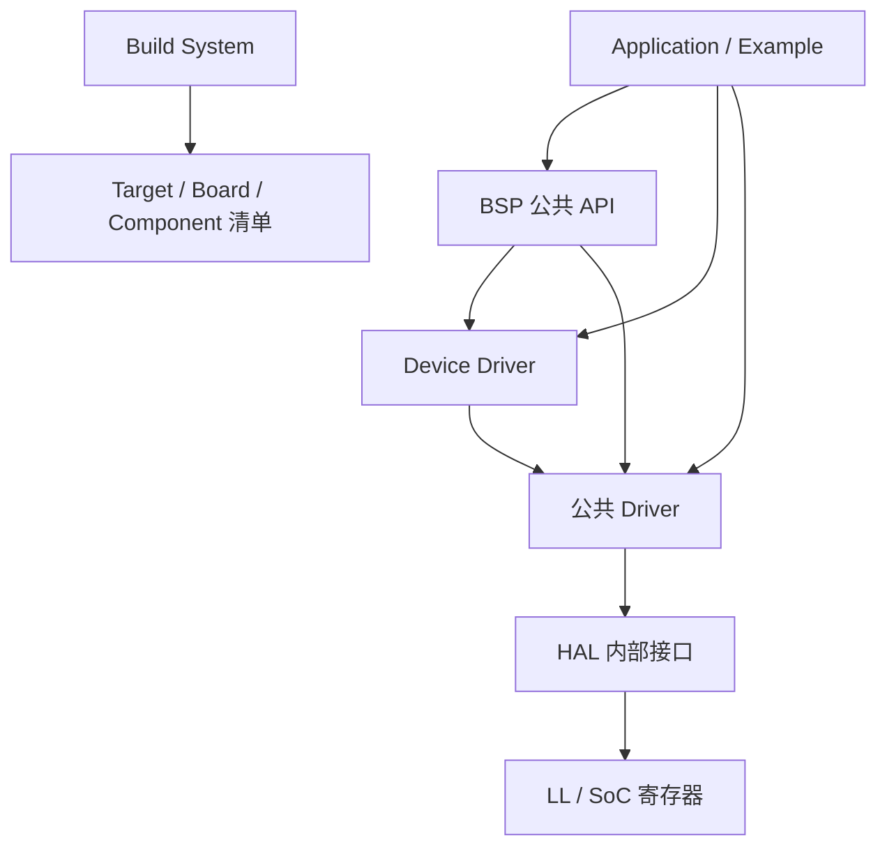

# ECOS SDK 3.0

!!! info "版本状态"

    本文对应 ECOS Embedded SDK 3.0。`tools/sdk-manifest.json` 中 `sdk_version` 为
    `3.0.0`，当前发布通道为 `development`，CLI 版本为 `3.0.0.dev0`。3.0 仍在持续
    开发中，命令、清单和公共 API 可能继续调整；发布版行为以对应 Git tag 和 SDK
    清单为准。

本页是 SDK 3.0 文档入口，介绍版本定位、架构分层和板卡支持。安装、CLI、工程配置、应用接口、示例与迁移分别见下方“文档地图”。

## 文档地图

| 主题 | 页面 |
| --- | --- |
| 安装与工具链 | [安装 SDK 3.0](install.md) |
| 创建、构建、烧录 | [快速上手](quickstart.md) |
| 命令、JSON 输出与自动化 | [`ecos` 命令行工具](cli.md) |
| 工程结构与配置 | [工程与配置](project.md) |
| 应用接口总览 | [应用开发](api/index.md) |
| 错误、日志与标准骨架 | [错误、日志与标准骨架](api/core.md) |
| BSP / Driver / Device / Component | [BSP](api/bsp.md) · [Driver](api/driver.md) · [Device](api/device.md) · [Component](api/components.md) |
| 示例 | [示例工程](examples.md) |
| 从 2.0 迁移 | [从 SDK 2.0 迁移](migration.md) |
| 故障排查 | [故障排查](troubleshooting.md) |

## 定位

ECOS SDK 3.0 是面向 StarrySky 板卡和兼容 RISC-V 平台的轻量、模块化裸机 SDK。
它借鉴 ESP-IDF 在 Target、SoC、Driver、BSP、Component 和 Example 上的职责分离，
但不以兼容 ESP-IDF API 或组件生态为目标。

3.0 的核心约束：

- 裸机和静态链接是默认运行模型，不依赖 RTOS。
- 同一功能的 Example 只维护一份应用源码，板卡差异由 Target/Board/Driver/BSP 屏蔽。
- 工程通过清单和统一解析器选择 SDK、Board、Target 和组件，不复制 SDK 源码。
- 核心构建使用 **CMake + Ninja**，主机侧编排使用 **Python `ecos` CLI**。
- Windows、Linux 和 macOS 使用同一版本的 xPack RISC-V 工具链。
- CLI 的发现、校验、构建和诊断都提供机器可读的 JSON 输出，方便 CI 和 AI 调用。

## 工具链与版本基线

| 项目 | 基线 |
| --- | --- |
| SDK 版本 | `3.0.0`（`tools/sdk-manifest.json`） |
| CLI 版本 | `3.0.0.dev0`（Python 包） |
| 交叉工具链 | xPack GNU RISC-V Embedded GCC `15.2.0-1` |
| 编译器前缀 | `riscv-none-elf-` |
| CMake | 最低 3.20，安装器锁定 `3.31.10` |
| Ninja | 最低 1.10，安装器锁定 `1.11.1.4` |
| Python | 3.9 或更高版本 |
| 支持宿主 | Linux x86_64/arm64、macOS x86_64/arm64、Windows x86_64 |

!!! note "SDK 版本唯一来源"

    SDK 版本来自 `tools/sdk-manifest.json` 的 `sdk_version`，不能从 CLI 包版本、
    Git 分支名或安装目录名推断。`ecos --version` 显示的是 CLI 版本，不等于 SDK 版本。

## 架构分层

### 分层模型

| 层 | 职责 | 应用是否可直接使用 |
| --- | --- | --- |
| Application / Example | 业务逻辑 | 是（用户代码） |
| BSP | 板级资源：Console、LED、Button、Display、烧录与串口参数 | 是 |
| Device Driver | ST7735、AHT20、SGP30 等外部器件 | 是 |
| Driver | GPIO、UART、I2C、PWM、QSPI、Timer 等稳定外设接口 | 是 |
| HAL / LL / SoC | 寄存器操作和 SoC 适配 | **否**，SDK 内部接口 |
| Component | libc、heap、SFUD、FatFs、Shell 等软件组件 | 是 |

### 应用可见的公共接口

应用只应包含以下头文件：

| 头文件 | 内容 |
| --- | --- |
| `ecos/error.h` | 错误码、结果判定与控制流宏 |
| `ecos/log.h` | 日志与 panic |
| `ecos/driver/<mod>.h` | 外设 Driver，例如 `gpio.h`、`uart.h`、`i2c.h` |
| `ecos/bsp/<res>.h` | BSP，例如 `console.h`、`led.h`、`button.h` |
| `ecos/device/<dev>.h` | 外部器件 Driver，例如 `st7735.h`、`aht20.h` |
| `ecos/board_resources.h` | 由 CLI 按 Board 清单生成的板级资源宏 |
| `ecos/heap.h`、`sfud.h`、`ff.h` 等 | 选中组件公开的头文件 |

### 应用不得直接使用

- `hal/` 下的 `ecos/hal/*.h`：SDK 内部接口，跨版本不承诺稳定。
- `components/soc/*/include/*_soc.h`：SoC 寄存器定义。
- 板卡 `board.h`、引脚复用魔法数或直接写死的 GPIO 编号。
- 旧版 `components/core/include/log.h`、`hal_*.h` 等兼容头文件。

!!! warning "同名类型冲突"

    旧 `hal/i2c/hal_i2c.h`、`hal/timer/hal_timer.h` 与新 Driver 头文件存在
    `hal_i2c_config_t` / `hal_timer_config_t` 同名类型。3.x 应用应只包含
    `ecos/driver/i2c.h` 和 `ecos/driver/timer.h`，不要在同一编译单元混用两代头文件。

## 支持的板卡与 Target

Board 描述具体开发板，Target 描述 SoC。工程选择 Board 时，Target 由 Board 清单
自动派生，二者不会保存为互相冲突的两份选择。

| Board ID | 别名 | Target | 默认 profile | 其他 profile | 对应板卡文档 |
| --- | --- | --- | --- | --- | --- |
| `starrysky-l4-c1` | `l4c1` | `ysyx-2512-1` | `memory` | — | [星空 L4.0](../../brd/starry-sky-l/v4.0.md) |
| `starrysky-l4-c2` | `l4c2` | `ysyx-2512-1` | `memory` | — | [星空 L4.0](../../brd/starry-sky-l/v4.0.md) |
| `starrysky-l4-c3` | `l4c3` | `ysyx-2512-2` | `memory` | — | [星空 L4.0](../../brd/starry-sky-l/v4.0.md) |
| `starrysky-t1-pico` | `t1-pico` | `cl1-2512` | `flash_xip` | — | [星空 T1.0 Pico](../../brd/starry-sky-t/v1.0_pico.md) |
| `starrysky-l3` | `l3` | `ysyx-l3` | `flash-xip` | `mem` | [星空 L3.0](../../brd/starry-sky-l/v3.0.md) |
| `starrysky-l3-1` | `l3_1`、`l3-1` | `ysyx-l3-1` | `flash-xip` | `mem` | [星空 L3.1](../../brd/starry-sky-l/v3.1.md) |
| `starrysky-c1` | `c1` | `ysyx-c1` | `flash-xip` | — | [星空 C1.0](../../brd/starry-sky-c/v1.0.md) |
| `starrysky-c2` | `c2` | `ysyx-c2` | `flash-xip` | `psram-data` | [星空 C2.0 Pico](../../brd/starry-sky-c/v2.0_pico.md) |

说明：

- profile ID 由 Board 清单定义，拼写并不完全统一（例如 `flash-xip` 与 `flash_xip`），
  使用时应以 `ecos board describe <board>` 的结果为准。
- 不是所有 Example 都支持所有 Board。创建工程前可用 `ecos project list` 查看
  Example 与 Board 的兼容关系。
- L4C1/L4C2 共用 `ysyx-2512-1`，L4C3 使用 `ysyx-2512-2`；C1/C2、L3/L3.1 和
  T1-Pico 分别使用各自的 SoC。

## 进一步阅读

SDK 仓库（`3.0-dev` 分支）内提供了更细的参考：

| 文档 | 内容 |
| --- | --- |
| [`docs/api/README.md`](https://github.com/openecos-projects/embedded-sdk/blob/3.0-dev/docs/api/README.md) | 公共 API 总览、分层与错误模型 |
| [`docs/api/bsp.md`](https://github.com/openecos-projects/embedded-sdk/blob/3.0-dev/docs/api/bsp.md) | BSP：Console、LED、Button、板级资源 |
| [`docs/api/core.md`](https://github.com/openecos-projects/embedded-sdk/blob/3.0-dev/docs/api/core.md) | 核心运行时：错误码与日志 |
| [`docs/cli.md`](https://github.com/openecos-projects/embedded-sdk/blob/3.0-dev/docs/cli.md) | CLI 命令层级、参数和机器接口 |
| [`docs/install.md`](https://github.com/openecos-projects/embedded-sdk/blob/3.0-dev/docs/install.md) | 安装、离线安装、多版本和卸载 |
| [`docs/schemas.md`](https://github.com/openecos-projects/embedded-sdk/blob/3.0-dev/docs/schemas.md) | Board/Target/Component/Example schema |
| [`docs/sdk-3.0-development-boundary.md`](https://github.com/openecos-projects/embedded-sdk/blob/3.0-dev/docs/sdk-3.0-development-boundary.md) | 3.0 的架构边界和发布验收条件 |
| [`docs/api/`](https://github.com/openecos-projects/embedded-sdk/tree/3.0-dev/docs/api) | 各 Driver、Device 和 Component 的详细参考 |

板卡引脚、接口和原理图请查阅本站板卡百科中的对应型号页面。
